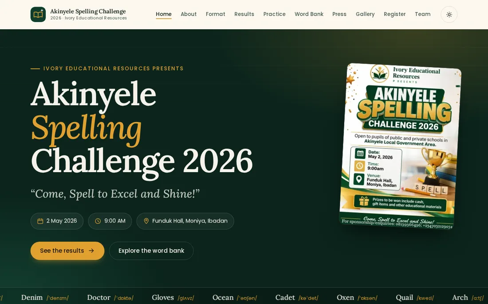

<div align="center">


# Akinyele Spelling Challenge 2026

*"Come, Spell to Excel and Shine!"*

[](https://github.com/babatundeawo/akinyele-spelling-challenge/actions/workflows/deploy.yml)
[](https://babatundeawo.github.io/akinyele-spelling-challenge/)

[**Live site**](https://babatundeawo.github.io/akinyele-spelling-challenge/) · [Documentation](docs/) · [Report an issue](https://github.com/babatundeawo/akinyele-spelling-challenge/issues/new/choose)

</div>

<p align="center">
  
</p>

## About

The Akinyele Spelling Challenge is a grassroots spelling competition for primary school pupils across Akinyele LGA, Ibadan, presented by Ivory Educational Resources. The maiden edition took place on 2 May 2026 at Funduk Hall, Moniya. This site is its official record: results, format, register, photos, press coverage and a word bank that anyone can use to practise.

## Features

- Results with the champion, runners-up and judging panel
- Competition format, rules and eligibility
- A 330-word UK-English word bank with meanings, IPA pronunciations and example sentences
- A practice trainer and a 10-round Spelling Bee game against a simulated rival, with optional spoken words
- A searchable register of the 48 contestants and 20 participating schools
- Photo gallery with a keyboard-friendly viewer, and press coverage
- Light and dark themes that follow your device setting
- Works on phones from 320 px wide, with the core content readable without JavaScript

## How to use it

Open the [live site](https://babatundeawo.github.io/akinyele-spelling-challenge/) in any modern browser.

| I want to | Go to |
| --- | --- |
| See who won | [Results](https://babatundeawo.github.io/akinyele-spelling-challenge/results.html) |
| Practise spelling | [Practice](https://babatundeawo.github.io/akinyele-spelling-challenge/practice.html) |
| Study the word list | [Word Bank](https://babatundeawo.github.io/akinyele-spelling-challenge/wordbank.html) |
| Find a pupil or school | [Register](https://babatundeawo.github.io/akinyele-spelling-challenge/contestants.html) |
| Contact the organisers | [Team](https://babatundeawo.github.io/akinyele-spelling-challenge/team.html#contact) |

## Tech stack

HTML, CSS (custom properties design system) and vanilla JavaScript (ES modules). A small dependency-free Node script assembles the pages. GitHub Actions builds and deploys to GitHub Pages.

## Project structure

```
.
├── *.html          Page sources (11 pages, including the 404 page)
├── partials/       Shared page frame: head, header, footer, icons, manifest
├── css/            The stylesheet and its design tokens
├── js/             Site behaviour and one module per interactive page
├── data/           Word bank, contestants, schools and gallery captions (JSON)
├── assets/         Fonts, icons, images and the social preview image
├── build/          Build and quality-check scripts
├── docs/           Deployment and customisation guides
└── .github/        Workflows, Dependabot, issue and pull request templates
```

## Contributing

Spotted a mistake or have an idea? [Open an issue](https://github.com/babatundeawo/akinyele-spelling-challenge/issues/new/choose) on GitHub. To propose a change, see [CONTRIBUTING.md](CONTRIBUTING.md).

## Security

Please report vulnerabilities privately, as described in [SECURITY.md](SECURITY.md).

## Credits

- Headlines set in [Lora](https://fonts.google.com/specimen/Lora) and text in [Poppins](https://fonts.google.com/specimen/Poppins), both under the [SIL Open Font License 1.1](https://openfontlicense.org/), self-hosted.
- Event photography by SDC Photography.
- Presented by Ivory Educational Resources. Site by [Techbase Consultant Services](https://techbasengr.com.ng/).

## Contact

ivoryeducationalresources@gmail.com · [@ivory_edu on Instagram](https://instagram.com/ivory_edu)
